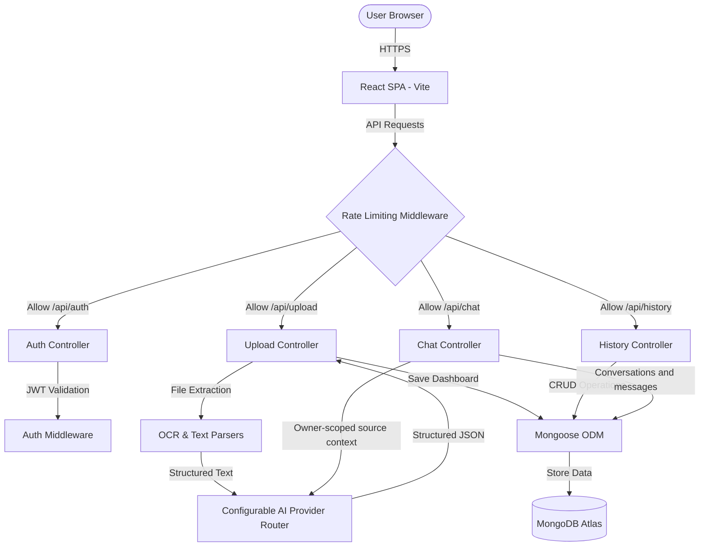

# DocDash AI 📊

> **An AI-powered workspace that turns supported business documents into interactive dashboards and grounded multi-document conversations.**

[](https://nodejs.org)
[](https://vitejs.dev)
[](https://openrouter.ai/)
[](https://mongodb.com)

🔗 **Live Demo:** [doc-to-dashboard.vercel.app](https://doc-to-dashboard.vercel.app)

---

## 🎯 The Problem Solved

Businesses waste thousands of hours manually reading PDFs, financial invoices, and messy spreadsheets to extract insights. **DocDash AI** eliminates this by acting as an autonomous data pipeline. Users can upload any unstructured document, and the AI instantly generates a highly-structured, interactive Recharts dashboard — no manual data entry, no complex prompt engineering, and no coding required.

## ✨ Core Features

- **📄 Multi-Document Upload** — Analyze up to five PDF, Excel, CSV, TXT, or JSON files per upload (20 MB per file).
- **🤖 AI Extraction with Fallback** — Configure OpenRouter, OpenAI, Groq, or Gemini-compatible chat-completion providers; retries and fallback stay server-side.
- **💬 Chat with Documents** — Ask grounded follow-up questions across up to five saved documents, with source-file references and optional charts. Conversations are stored per user.
- **🔎 Retrieval-Augmented Answers** — Documents are chunked with page/sheet locators; questions retrieve the best passages with BM25 (plus optional embeddings) and answers cite them as `[C1]`-style references.
- **🤖 Multi-Agent Pipeline** — A planner routes each question; a retriever and a deterministic analyst run in parallel; a synthesizer writes the cited answer; a verifier flags unsupported claims. Progress streams over SSE.
- **📈 Computed Insights & Comparison** — Trusted code computes totals, trends, robust anomalies, correlations, and cross-document KPI deltas; the model explains, it does not invent numbers.
- **🕸️ Data Map** — An entity/metric relationship graph across selected documents, rendered as an interactive force-directed map with shared-entity bridges.
- **⚙️ Scalable Backend** — Async upload jobs with progress polling, request correlation IDs with structured logs, per-user token metering and optional daily budgets, cross-document search, and conversation rename/delete/export.
- **📊 Dynamic Dashboards** — Auto-generates Bar, Line, Pie, and Area charts (via Recharts) alongside critical KPI summary cards based entirely on the AI's contextual understanding of the document.
- **📝 Tabbed Data Editor** — Because AI isn't flawless, users have access to a built-in, tabbed Data Editor to manually correct AI hallucinations, edit KPIs, or tweak the raw JSON array before exporting.
- **💎 Premium UI/UX** — Modern, dark-mode aesthetic featuring deep glassmorphism (`backdrop-filter`), glowing SVG pipelines, and buttery-smooth `framer-motion` page transitions.
- **🔐 Secure Authentication** — Full JWT-based auth flow (Login/Signup) with secure session management.
- **👤 User Profiles & Preferences** — Dedicated settings page for account security and mock data privacy toggles.
- **💾 Cloud Document History** — A collapsible sidebar that saves analyzed dashboards and bounded source text in MongoDB.
- **⬇️ Comprehensive Exports** — Unified export dropdown to download the final dashboard as a **PDF Report**, **PNG Image**, **CSV Tables**, or raw **JSON Data**.
  
## 🛠️ System Architecture & Tech Stack

The application is built on a decoupled **Client-Server Architecture** designed for high throughput, robust security, and clean separation of concerns.

### 🌐 System Architecture Diagram


### 💻 Technology Stack

| Layer | Technology | Role |
|-------|------------|------|
| **Frontend SPA** | React 18, Vite, Framer Motion, Lucide React | Modern dark-mode UI with fluid page transitions and SVG workflows. |
| **Data Visualization** | Recharts | Generates interactive, responsive Bar, Line, Pie, and Area charts. |
| **Export Engines** | html2canvas, jsPDF | Renders and downloads dashboards as PDF reports, PNG images, and CSV tables. |
| **Backend API Gateway** | Node.js, Express | Modular routing layer with standard CORS controls (`GET`, `POST`, `PUT`, `DELETE`). |
| **Security & Rate Limiting** | JWT (JSON Web Tokens), `express-rate-limit` | Multi-tier rate limiting (Auth: 10 req/15m, Uploads: 5 req/1m, API: 100 req/15m) to protect LLM costs and resist brute-force attacks. |
| **AI Pipeline Engine** | OpenAI-compatible provider router | Configurable OpenRouter, OpenAI, Groq, or Gemini provider/model, bounded retries/timeouts, and sequential fallback. |
| **Data Parsing Engines** | `pdfjs-dist`, `xlsx`, `csvtojson` | Local parsing for text PDFs, spreadsheets, CSV, TXT, and JSON. |
| **Persistence Layer** | MongoDB Atlas, Mongoose | User accounts, dashboards, extracted-text excerpts, and owner-scoped conversations. |

## 🚀 Getting Started

### Prerequisites
- Node.js 18+
- At least one configured AI provider API key
- MongoDB URI and a long random JWT secret for authentication, history, and chat

### 1. Backend Setup
```bash
cd backend
npm install
# Copy .env.example to .env and configure MongoDB, JWT, and one AI provider
npm start
```

### 2. Frontend Setup
```bash
cd Frontend
npm install
npm run dev
```

Open **http://localhost:5173** 🎉

## 📁 Project Structure

```text
doc-to-dashboard/
├── backend/
│   ├── server.js                  # Express entry point & CORS policy
│   ├── routes/
│   │   ├── auth.js                # Auth routes (Login, Signup)
│   │   ├── upload.js              # File upload routing
│   │   └── history.js             # Document dashboard CRUD routes
│   ├── controllers/
│   │   ├── authController.js      # Auth business logic & JWT generation
│   │   ├── uploadController.js    # Multer handling + LLM parsing integration
│   │   └── historyController.js   # DB retrieval & manual dashboard edit saves
│   ├── middleware/
│   │   ├── authMiddleware.js      # JWT token verification
│   │   └── rateLimiter.js         # Dedicated rate limiting policies
│   ├── services/
│   │   ├── aiService.js           # Groq SDK configuration & JSON schema generation prompt
│   │   └── ocrService.js          # File type validation & text parsing streams
│   └── models/
│       ├── User.js                # Mongoose Schema for accounts
│       └── Document.js            # Mongoose Schema for dashboard histories
└── Frontend/
    ├── public/
    │   └── logo.png               # Custom branding logo asset
    └── src/
        ├── App.jsx                # Router, Auth State management, & API endpoints
        ├── landing.css            # Dark mode branding design system
        ├── components/
        │   ├── Dashboard.jsx      # Recharts visual dashboard engine
        │   ├── DataEditor.jsx     # Tabbed raw data & KPI editing UI
        │   ├── ChartCard.jsx      # Generic chart container
        │   └── KPICard.jsx        # Summary metrics indicator
        └── pages/
            ├── LandingPage.jsx    # Hero page with interactive SVG data-flow animation
            └── UserProfile.jsx    # Settings page with mock privacy switches
```
## 🔑 Environment Variables
```env
# backend/.env
MONGODB_URI=mongodb+srv://<username>:<password>@cluster.mongodb.net/doc-to-dashboard
JWT_SECRET=replace_with_a_long_random_secret
PORT=5000
CLIENT_URL=http://localhost:5173

AI_PRIMARY_PROVIDER=openrouter
AI_FALLBACK_PROVIDER=groq
AI_REQUEST_TIMEOUT_MS=45000
AI_RETRIES=1
OPENROUTER_API_KEY=
GROQ_API_KEY=
OPENAI_API_KEY=
GEMINI_API_KEY=

# Optional; disabled when empty. Prefer an external uptime monitor in production.
KEEP_ALIVE_URL=
KEEP_ALIVE_INTERVAL_MS=600000
```

Copy `backend/.env.example` to `backend/.env` and set real credentials locally. The API exposes `/health` for liveness and `/ready` for MongoDB readiness. Optional keep-alive pings are disabled unless configured, limited to at most one every five minutes, and cannot prevent host-enforced sleeps or cold starts. DocDash does not execute AI-generated code; scanned/image-only PDFs and image uploads are not currently supported.

### API Overview

| Endpoint | Purpose |
|---|---|
| `POST /api/upload`, `POST /api/upload/batch` | Synchronous single/multi-file analysis (max 5 files, 20 MB each) |
| `POST /api/upload/async` → `GET /api/insights/jobs/:id` | Queued batch processing with progress polling |
| `POST /api/chat`, `POST /api/chat/stream` | Agentic document chat (JSON or server-sent events with step progress) |
| `GET /api/chat?page=&limit=&q=`, `PATCH /api/chat/:id`, `DELETE /api/chat/:id`, `GET /api/chat/:id/export?format=md\|json` | Conversation management and export |
| `POST /api/insights/graph` | Relationship map (entities, metrics, documents) with per-document caching |
| `POST /api/insights/analysis` | Deterministic insights and KPI comparison for selected documents |
| `GET /api/insights/search?q=` | Passage search across your recent documents |
| `GET /api/insights/usage/me` | Token usage summary and job-queue stats |

Set `AI_EMBEDDINGS_PROVIDER` to enable hybrid semantic retrieval; otherwise retrieval is lexical. `AI_USER_DAILY_TOKEN_BUDGET` caps per-user daily tokens; `AI_PLANNER`/`AI_VERIFIER` can be set to `off` to reduce model calls. The in-process job queue is per instance; use a shared queue before running multiple API replicas.